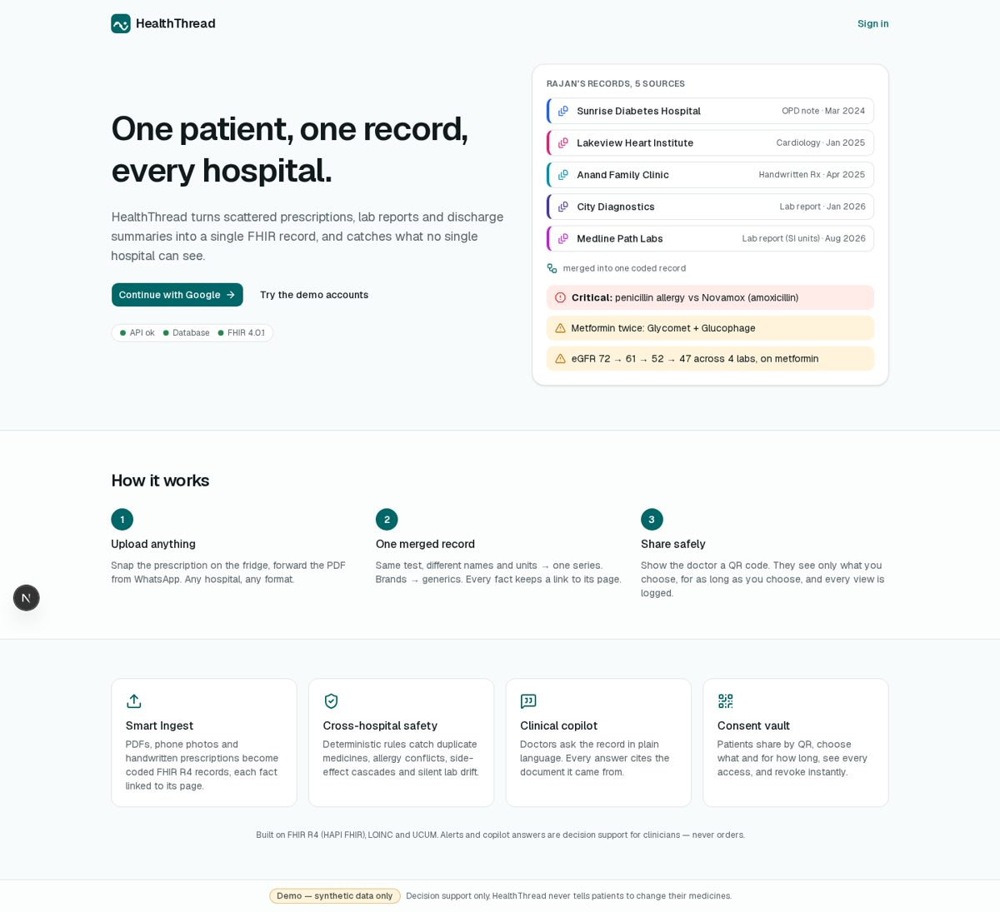
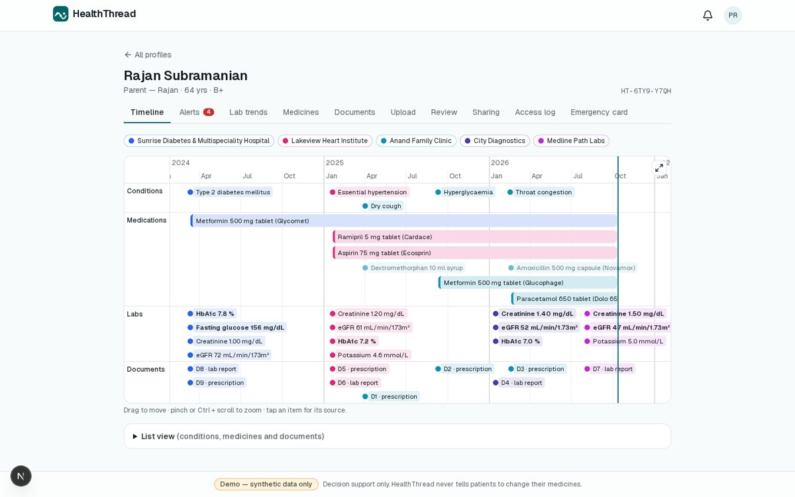
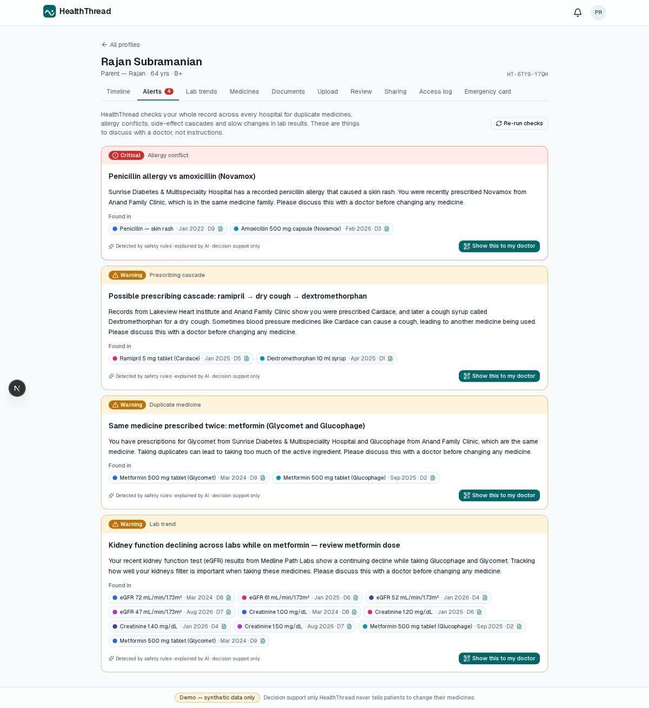
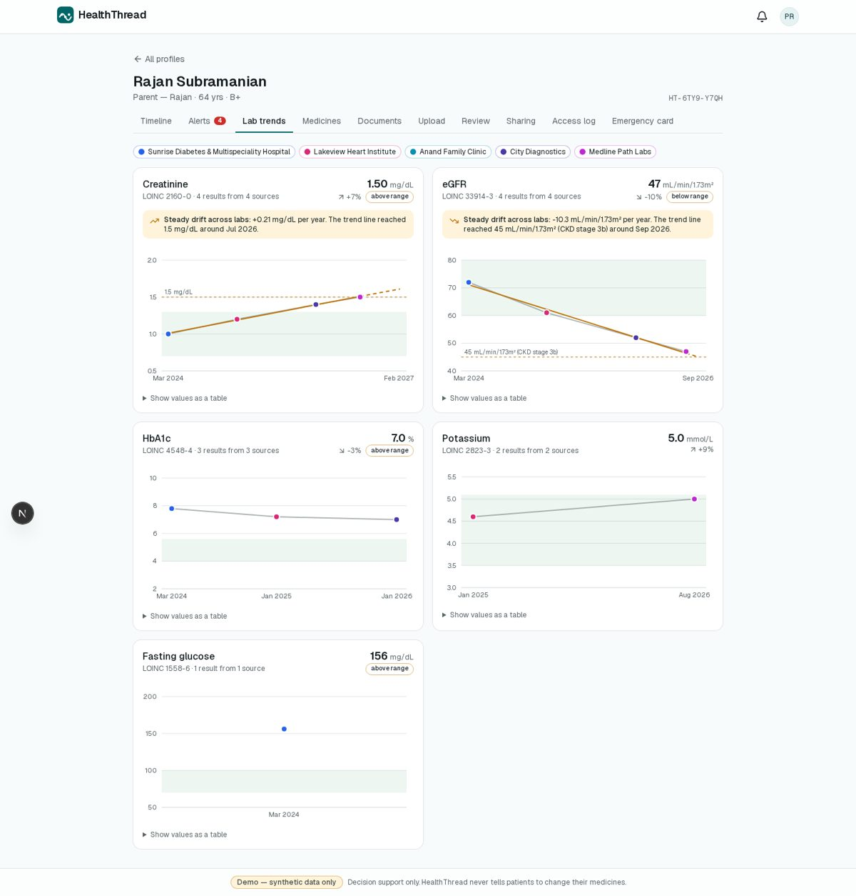
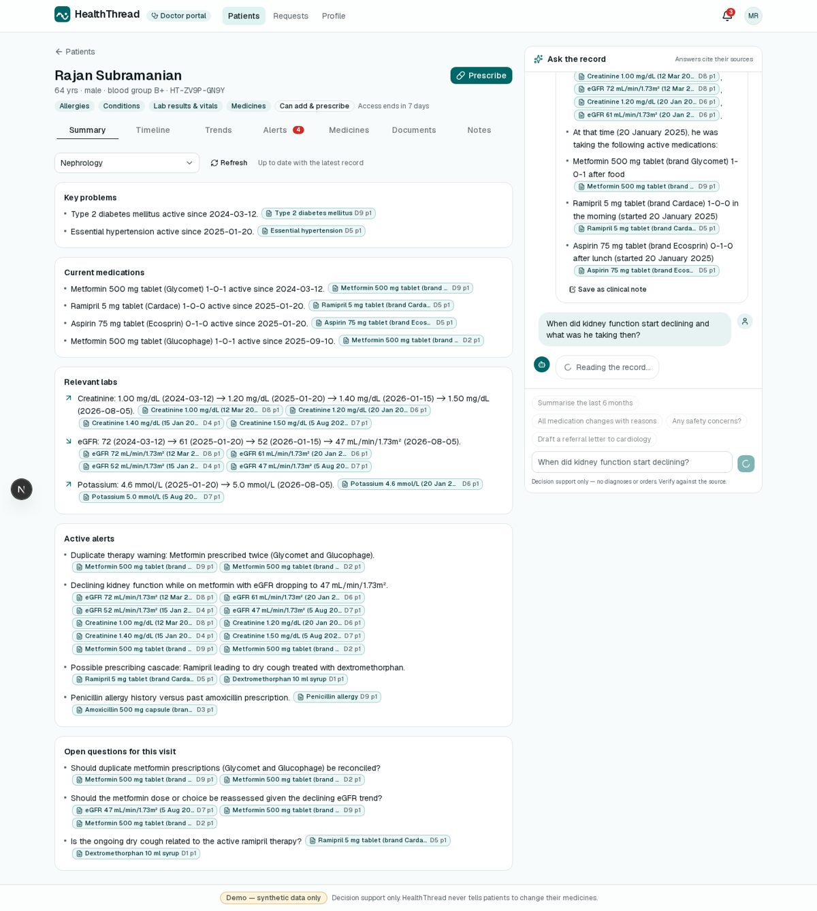
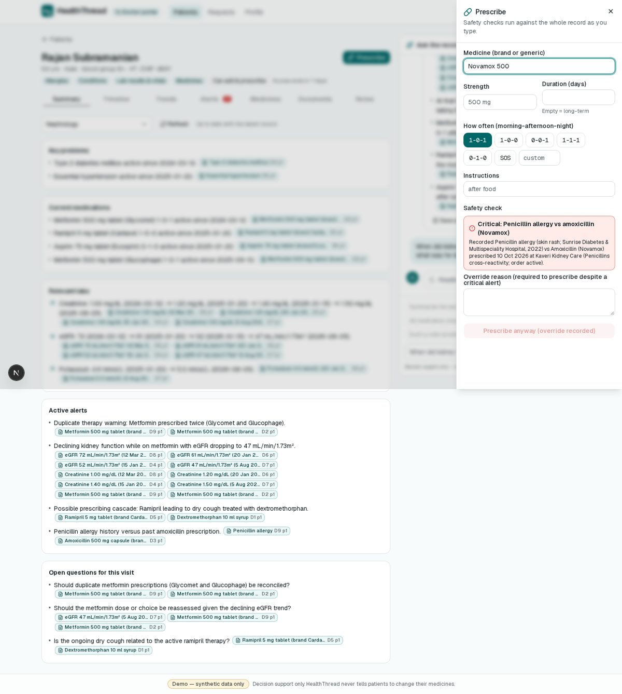
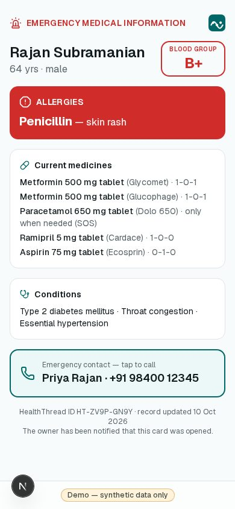
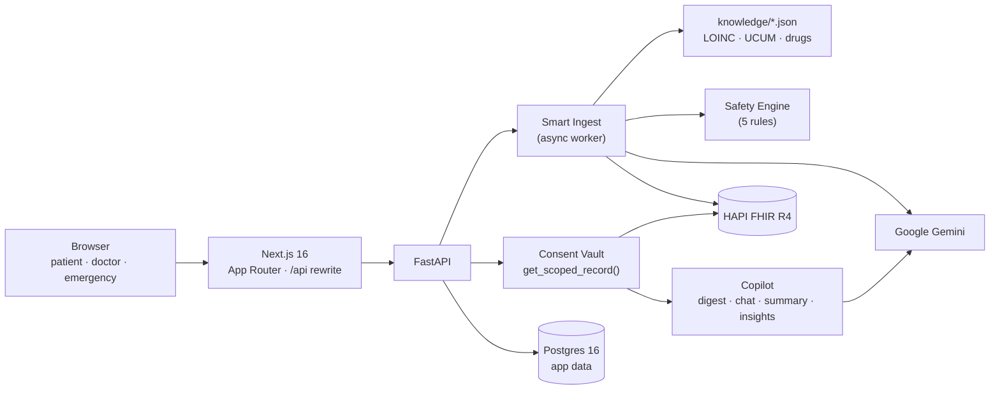

# HealthThread

> One patient, one record, every hospital — and it catches what no single hospital can see.

HealthThread turns scattered medical documents (PDFs, phone photos, handwritten prescriptions) from many hospitals into **one FHIR R4 record**. On top of that record it runs a **deterministic cross-hospital safety engine**, gives doctors an **AI copilot that cites its sources**, and lets patients **control access** with consent-based sharing and an emergency card.

**All data in this project is synthetic.** Alerts and copilot answers are decision support, never medical orders.



| Timeline across 5 sources | Cross-hospital alerts | Lab trends with drift |
|---|---|---|
|  |  |  |

| Doctor workspace with cited copilot | Prescribe-time safety check | Emergency card |
|---|---|---|
|  |  |  |

## What it does

| Engine | What you get |
|---|---|
| **1 · Smart Ingest** | Upload PDF, JPG or PNG files. Gemini extracts the contents into a strict JSON schema. Deterministic code then maps lab names to LOINC, converts units to UCUM (133 µmol/L creatinine → 1.50 mg/dL), maps brands to generics with drug classes, merges with the existing record, and writes one FHIR transaction Bundle with **Provenance down to the source page and snippet**. Anything below 0.80 confidence goes to a review queue first. |
| **2 · Safety Engine** | Five rule families run on the merged record: duplicate therapy, allergy cross-reactivity, prescribing cascades, lab drift (regression and projection) and drug interactions. Every alert links to its evidence. The LLM only writes the plain-language explanation. |
| **3 · Clinical Copilot** | Specialty summaries, streaming chat with citation chips that open the original page with the value highlighted, and panel-wide insights through function calling. Everything is grounded only in what the doctor is allowed to see. |
| **4 · Consent Vault** | QR or ID-based sharing with scopes (mental health is off by default), expiry, instant revoke, a patient-visible access log, FHIR Consent and AuditEvent mirroring, and a public emergency card (allergies, medicines, blood group, contact) with an owner notification on every view. |

Portals: a phone-first **patient and caregiver** app (one account manages several family profiles), a desktop **doctor** portal (risk-sorted panel and split-view workspace), an **admin** console for doctor verification, and the public **emergency card**.

## Architecture



The details are in [docs/ARCHITECTURE.md](docs/ARCHITECTURE.md): the ingest sequence, consent enforcement, rule table and AI usage. Deviations from the spec, such as using Gemini instead of Claude, are recorded in [docs/DECISIONS.md](docs/DECISIONS.md).

**Stack:** Next.js 16 (App Router, TypeScript), Tailwind v4, shadcn/ui, TanStack Query, vis-timeline, Recharts, react-pdf · FastAPI, SQLAlchemy 2 (async), Alembic, Pydantic v2 · Postgres 16 · HAPI FHIR JPA (R4) · Google Gemini (`google-genai`) · Docker Compose.

## Run it from a clean clone

**Prerequisites:** Docker with Compose, Python 3.11, Node 20+ (tested on Node 26), and a Gemini API key from <https://aistudio.google.com/apikey>.

```bash
# 1. Configure
cp .env.example .env
#    set GEMINI_API_KEY and JWT_SECRET (python3 -c "import secrets;print(secrets.token_urlsafe(48))")
#    optional: GOOGLE_CLIENT_ID / NEXT_PUBLIC_GOOGLE_CLIENT_ID for real Google sign-in (below)

# 2. Databases: one Postgres 16 container (app, hapi and test DBs) + HAPI FHIR
docker compose up -d
#    HAPI needs ~60–90 s on first boot:  curl -s localhost:8080/fhir/metadata | head -c 200

# 3. Backend
cd backend
python3.11 -m venv .venv
.venv/bin/pip install -r requirements-dev.txt
.venv/bin/alembic upgrade head
.venv/bin/python -m scripts.seed_demo --reset          # demo world (see below)
.venv/bin/uvicorn app.main:app --port 8000             # leave running

# 4. Frontend (new terminal)
cd frontend
npm install
npm run dev                                            # http://localhost:3000
```

The status pill on the landing page should read **API ok · Database · FHIR 4.0.1**. You can also check from the shell with `curl localhost:8000/api/health`.

**Reset:**
- `python -m scripts.seed_demo --reset` wipes the app data and every profile's FHIR data, then reseeds.
- `docker compose down -v` deletes the database volume completely. After it, run `alembic upgrade head` again.

### Demo data and accounts

`scripts/generate_demo_docs.py` deterministically renders the synthetic documents into `demo_data/`:
- **Rajan** has 9 documents from 5 hospitals, clinics and labs, with a different style for each: typed letterheads, a table lab report, a report in SI units and photos of handwritten prescriptions.
- **Lakshmi** has 3 documents and is the clean control patient.

The seed script sends them through the **same pipeline as an upload**.

| Command | Result |
|---|---|
| `python -m scripts.seed_demo --reset` (`--stage full`, the default) | Rajan fully ingested. Exactly **4 alerts**: penicillin allergy vs amoxicillin (critical), duplicate metformin, the ramipril → cough → dextromethorphan cascade, and eGFR drift while on metformin. Rajan is shared with Dr. Meena for 7 days. Lakshmi: 0 alerts, also shared. |
| `python -m scripts.seed_demo --reset --stage live` | Same people, but **Rajan's profile is empty and not shared**, so the demo can upload his documents and share by QR live. This mode is used in [docs/DEMO_SCRIPT.md](docs/DEMO_SCRIPT.md). |

The script exits non-zero if the alert set isn't exactly what the demo expects.

With `DEMO_MODE=true`, the login page shows one-click **demo accounts**:

| Account | Role |
|---|---|
| Priya (caregiver) | Patient account managing *Priya Rajan* (self) and *Rajan Subramanian* (father) |
| Dr. Meena Raghavan | Verified nephrologist, Kaveri Kidney Care |
| Dr. Arjun Mehta | Doctor still waiting for verification (blocked from patient data) |
| Admin | Doctor verification queue and system stats (no patient access) |

`POST /api/auth/demo` returns 404 when `DEMO_MODE=false`.

### Google sign-in (real accounts)

HealthThread uses the Google Identity Services **ID-token flow**, so no client secret or redirect URI is needed.

1. In Google Cloud Console, open **APIs & Services → OAuth consent screen**. Choose **External**, keep the app in *Testing*, and add your account(s) under **Test users**.
2. Open **APIs & Services → Credentials → Create credentials → OAuth client ID** and choose **Web application**.
3. Under **Authorized JavaScript origins**, add `http://localhost:3000` and your deployed URL.
4. Copy the client ID into `.env` as both `GOOGLE_CLIENT_ID` and `NEXT_PUBLIC_GOOGLE_CLIENT_ID`. Restart the backend and frontend.
5. Add your email to `ADMIN_EMAILS` if you want to become an admin on first sign-in.

New users pick a role at onboarding:
- **Patient:** creates their own profile with a HealthThread ID such as `HT-7K3M-9Q2P`.
- **Doctor:** enters registration details and waits for an admin to verify them.

### AI quota

Every model call goes through `backend/app/ai/client.py`.
- **Rate limiting:** a process-wide limiter (`AI_REQUESTS_PER_MINUTE`) paces the calls, and 429/503 responses are retried after Google's `retryDelay`.
- **Fallback model:** if the primary model's quota is exhausted (for example the free tier's daily cap), the call moves to `GEMINI_FALLBACK_MODEL`.
- **Upload speed:** on the **free tier** (5 requests/min) the 9-document upload takes about 2 minutes. On a paid key, raise `AI_REQUESTS_PER_MINUTE`.
- **`DEMO_CACHE=true`:** if extraction fails, the pipeline uses `backend/demo_cache/<sha256>.json`, the real recorded model output for that exact demo file. Nothing else is ever faked. If AI fails, chat, summary and insights show an error with a retry.

## Environment variables

| Variable | Purpose |
|---|---|
| `GOOGLE_CLIENT_ID`, `NEXT_PUBLIC_GOOGLE_CLIENT_ID` | OAuth web client ID (same value for both); optional when using demo accounts |
| `JWT_SECRET` | Signs the httpOnly `ht_session` cookie (8-hour sessions) |
| `ADMIN_EMAILS` | Comma-separated Google emails that become admins on first sign-in |
| `GEMINI_API_KEY` | Google AI Studio key — **keep only in `.env`** (gitignored) |
| `GEMINI_MODEL` / `GEMINI_FALLBACK_MODEL` | Primary and fallback models (`gemini-3.5-flash` / `gemini-3.5-flash-lite`) |
| `AI_REQUESTS_PER_MINUTE` | Client-side pacing to match your key's quota (free tier: 5) |
| `DATABASE_URL`, `TEST_DATABASE_URL` | Postgres (app / pytest), both served by the compose container |
| `FHIR_BASE_URL` | HAPI FHIR base, `http://localhost:8080/fhir` |
| `STORAGE_DIR` | Where uploaded files are stored (`./storage`, outside the web root) |
| `APP_BASE_URL`, `BACKEND_URL` | Frontend origin (CORS, QR links) and where Next.js proxies `/api/*` |
| `DEMO_MODE` | Enables demo accounts, the seed script and the demo badge |
| `DEMO_CACHE` | Allows the recorded-extraction fallback for the demo files |
| `DEFAULT_TIMEZONE`, `NEXT_PUBLIC_DEFAULT_TIMEZONE` | Display timezone (UTC is stored) |

## Tests

```bash
cd backend
.venv/bin/pytest                 # unit + API tests: rules, normalisation, merge, consent, copilot, auth
.venv/bin/ruff check . && .venv/bin/mypy app
cd ../frontend && npm run lint && npm run typecheck && npm run build
```

- **API tests** use the `healththread_test` database and an in-memory FHIR fake. The AI is stubbed only at the `ai/client.py` boundary, with real recorded extraction outputs as fixtures.
- **End-to-end checks** drive the running stack with Playwright. `backend/.venv/bin/python e2e/demo.py` runs the whole demo script after `seed_demo --reset --stage live`, from upload to emergency card. The `phase*.py` scripts cover single phases. Screenshots go to `e2e/screenshots/`.

## Project layout

```
backend/
  app/
    ai/              client.py (the only AI caller) + prompts/*.md
    knowledge/       LOINC map, brand→generic + classes, allergies, cascades, interactions, drift rules
    routers/         auth, onboarding, profiles, documents, review, record, alerts, clinical,
                     copilot, consents, emergency, notifications, doctor, admin, health
    services/
      ingest/        extract → normalize → merge → writer (FHIR Bundle) → pipeline/worker
      safety/        rules/*.py, engine (fingerprints, supersede), explain
      copilot/       digest (citation keys), chat (SSE), summary, insights (tools)
      consent.py     resolve_access · filter_record · get_scoped_record
      record.py      FHIR → PatientRecord dataclasses
  alembic/  scripts/ (generate_demo_docs, seed_demo)  tests/  demo_cache/
frontend/
  app/               /, /login, /onboarding, /app/..., /doctor/..., /admin, /share/[token], /emergency/[token]
  components/        patient/, doctor/, record/, copilot/, emergency/, shell/, ui/
  lib/               api client, hooks, types
docker/postgres/init/  creates the healththread, hapi and healththread_test databases
docs/                SPEC, PLAN, DECISIONS, ARCHITECTURE, DEMO_SCRIPT
e2e/                 Playwright walkthroughs
```

## Security notes

- Sessions use an httpOnly, SameSite=Lax cookie. Mutating requests need an `X-HT-Request` header (CSRF), and the frontend talks to the API same-origin.
- Uploads are checked by magic bytes, limited to 15 MB and 20 pages, stored outside the web root and served only after a consent check.
- Every doctor-facing read goes through `get_scoped_record()`, including AI prompts. Mental-health data needs an explicit scope.
- Emergency and share tokens are stored only as hashes. Public endpoints are rate-limited.
- Logs record only AI purpose, model, latency and token counts, never document contents.
