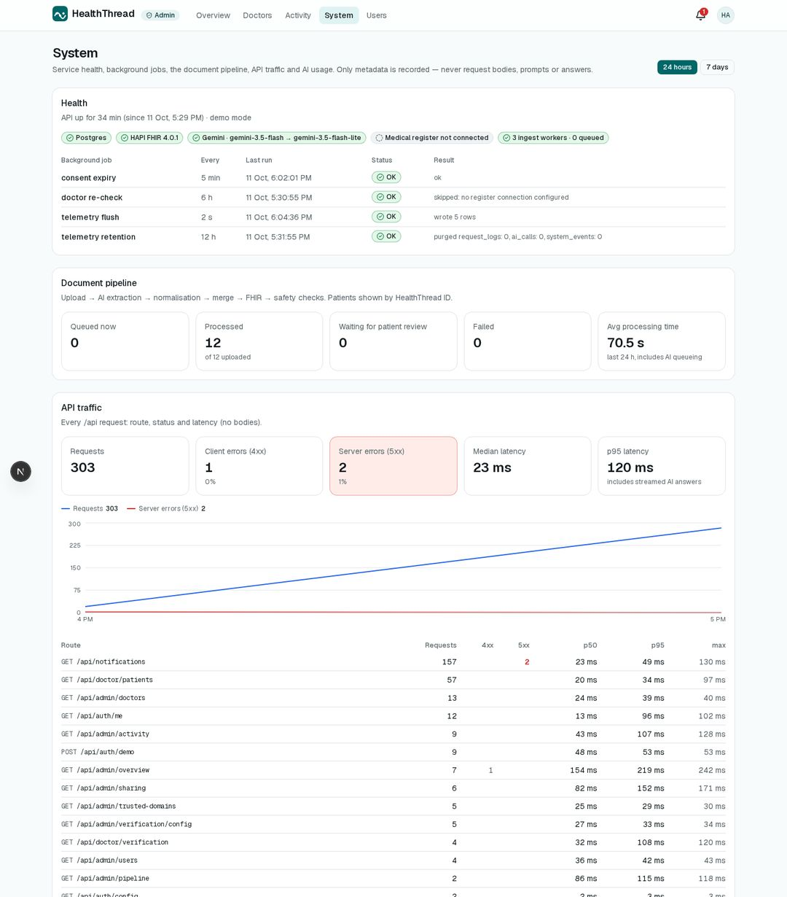
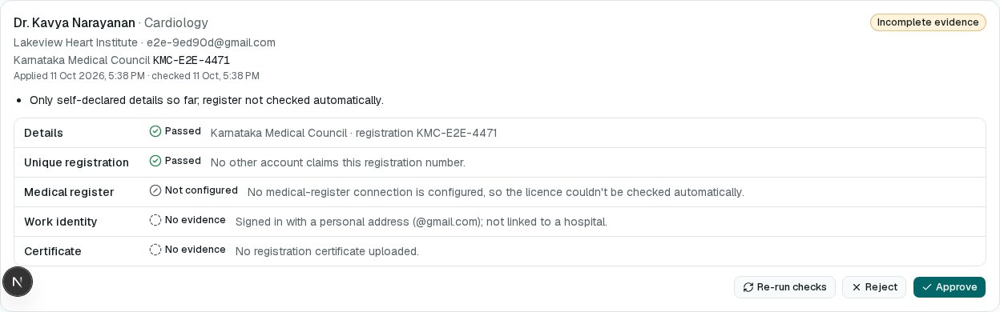
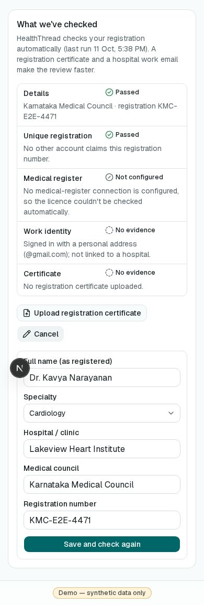
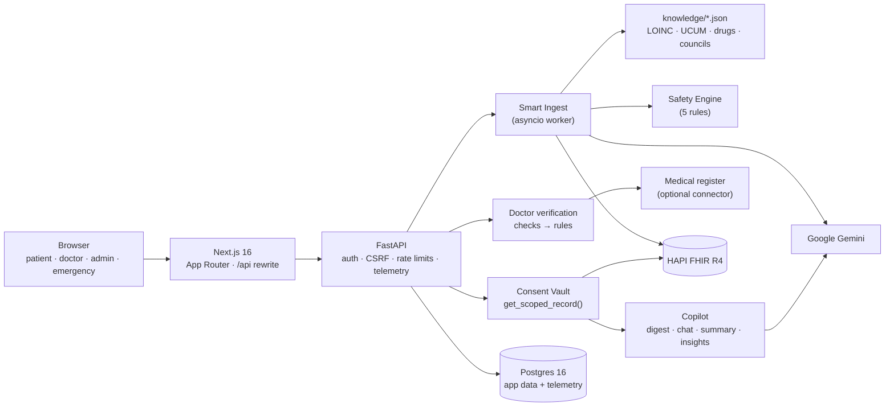

# HealthThread

> One patient, one record, every hospital — and it catches what no single hospital can see.

HealthThread turns scattered medical documents (PDFs, phone photos, handwritten prescriptions) from many hospitals into **one FHIR R4 record**. On top of that record it:
- runs a **deterministic cross-hospital safety engine**
- gives doctors an **AI copilot that cites its sources**
- lets patients **control who sees what** through consent-based sharing and an emergency card
- **verifies doctors automatically** against the evidence they provide
- gives admins a **live view of the whole platform** without exposing anyone's health data

**All data in this project is synthetic.** Alerts and copilot answers are decision support, never medical orders.


| Timeline across 5 sources | Cross-hospital alerts | Lab trends with drift |
|---|---|---|
|  |  |  |

| Doctor workspace with cited copilot | Prescribe-time safety check | Emergency card |
|---|---|---|
|  |  |  |

| Admin: system monitoring | Admin: doctor verification evidence | Doctor: own verification checks |
|---|---|---|
|  |  |  |

---

## Contents

1. [Features at a glance](#features-at-a-glance)
2. [Who uses it: the four portals](#who-uses-it-the-four-portals)
3. [How it works](#how-it-works)
   - [Smart Ingest](#1-smart-ingest) · [Safety Engine](#2-safety-engine) · [Clinical Copilot](#3-clinical-copilot) · [Consent Vault](#4-consent-vault) · [Emergency card](#emergency-card) · [Doctor verification](#doctor-verification) · [Admin monitoring](#admin-monitoring) · [Notifications](#notifications)
4. [Architecture](#architecture)
5. [Getting started](#getting-started)
6. [Demo data and accounts](#demo-data-and-accounts)
7. [Google sign-in](#google-sign-in)
8. [AI (Gemini) and quotas](#ai-gemini-and-quotas)
9. [Configuration reference](#configuration-reference)
10. [API reference](#api-reference)
11. [Data model](#data-model)
12. [Testing](#testing)
13. [Security and privacy](#security-and-privacy)
14. [Troubleshooting](#troubleshooting)
15. [Project layout](#project-layout)
16. [Documentation index](#documentation-index)
17. [Limitations and next steps](#limitations-and-next-steps)

---

## Features at a glance

| Area | What you get |
|---|---|
| **Smart Ingest** | Upload PDF, JPG or PNG. Gemini extracts into a strict schema. Then deterministic code:<br/>• maps lab names to **LOINC** and converts units to **UCUM** (133 µmol/L creatinine → 1.50 mg/dL)<br/>• maps brands to generics with drug classes<br/>• merges with the existing record<br/>• writes one FHIR transaction Bundle with **Provenance down to the source page and quoted snippet**<br/>Uncertain items go to a review queue first. |
| **Safety Engine** | Five rule families across all hospitals: duplicate therapy, allergy cross-reactivity, prescribing cascades, lab drift (regression and projection) and drug interactions. Every alert links to its evidence. AI only writes the plain-language explanation. |
| **Clinical Copilot** | Specialty summaries, streaming chat with **citation chips** that open the original page with the value highlighted, and panel-wide questions answered by AI function calling. All of it sees only what the doctor is allowed to see. |
| **Consent Vault** | QR or ID-based sharing with **scopes** (mental health off by default), expiry, instant revoke, a patient-visible **access log**, and FHIR Consent/AuditEvent mirroring. |
| **Emergency card** | A public QR card (allergies, current medicines, blood group, emergency contact) with a wallet PDF and lock-screen image. The owner is notified on every view. |
| **Prescribing safety** | Live checks while the doctor types. Critical conflicts need a written override reason. Prescriptions are saved as FHIR MedicationRequests, with a printable PDF. |
| **Doctor verification** | Five automated checks (format, duplicate claim, medical register, work email, certificate read by AI). Fixed rules decide clear cases; the rest are queued by risk. Periodic re-checks automatically suspend lapsed licences. |
| **Admin monitoring** | Live overview, activity log, API traffic, AI usage, document pipeline, background jobs, users. **Admins never see health data.** |
| **Patient explainer** | "Explain simply" for any document in English, Tamil or Hindi, grounded and cited. |
| **Interoperability** | HAPI FHIR R4 server, LOINC/UCUM/ICD-10 coding, and full-record export as a FHIR `collection` Bundle. |

---

## Who uses it: the four portals

### Patients and caregivers (`/app`, phone-first)
One Google account can manage several **health profiles**, for example yourself and a parent. Each profile has its own HealthThread ID (`HT-7K3M-9Q2P`).

| Page | What it does |
|---|---|
| **Home** `/app` | Profile cards with alert counts. *Add family member*. |
| **Timeline** | One colour-coded thread across hospitals (conditions, medicines, labs, documents). Tap an item to see where it came from and open the original page. |
| **Alerts** | Cross-hospital safety alerts in plain language, with source chips, *Show this to my doctor* and *Re-run checks*. |
| **Lab trends** | One chart per analyte (eGFR, creatinine, HbA1c…): reference band, points coloured by lab, regression line and dashed projection to a threshold. Tap a point to open the report. |
| **Medicines** | Current and past medicines, merged by generic name and showing brand and source. *Mark as stopped*. |
| **Documents** | Every upload with its status. In-app PDF/image viewer with highlights. *Explain simply* (EN/TA/HI). |
| **Upload** | Drag and drop or take a photo. Live stages: *Uploading → Reading → Extracting with AI → Normalising → Merging → Saving to FHIR → Safety checks → Done*. |
| **Review** | Items the AI wasn't sure about, shown next to a crop of the page. *Looks right / Correct / Not on the document*. |
| **Sharing** | Create a QR share (scopes, 24 h / 7 days / 30 days, optional "doctor may add documents and prescriptions"). Approve or deny doctors' requests. See and revoke active shares. |
| **Access log** | Every doctor view, chat, summary, upload, prescription and emergency access, in plain language. |
| **Emergency card** | Turn on or off, regenerate the QR, download the wallet PDF or lock-screen image. |
| **Settings** | Profiles, export the whole record as a FHIR Bundle, sign out. |

### Doctors (`/doctor`, desktop)
| Page | What it does |
|---|---|
| **Patients** `/doctor` | Panel sorted by risk (critical alerts first), eGFR sparklines, and access expiry. **Panel insights** box for questions like "Which of my patients have declining kidney function?". |
| **Workspace** `/doctor/patients/[id]` | Tabs: Summary (specialty, every line cited), Timeline, Trends, Alerts (mark *reviewed — intentional*), Medicines, Documents, Notes. **Copilot chat** alongside, with citation chips, *Save as clinical note*, **Prescribe** and **Upload** (when the patient allowed it). |
| **Requests** | Ask for access by HealthThread ID or email, choosing scopes and purpose. |
| **Profile** | Professional details, verification status, the **checks run on you**, certificate upload, and *Correct my details* (while pending or rejected). |
| **Claim a share** `/share/[token]` | Scan a patient's QR, sign in, and land back here to claim it. |

Unverified, rejected and suspended doctors see a status banner and no patient data.

### Admins (`/admin`)
| Page | What it does |
|---|---|
| **Overview** | Last 24 h: active users, sign-ins (and failures), uploads, doctor record access, AI calls and failures, server errors, access denials, emergency views. Also a 14-day activity chart, **Needs attention**, platform totals, sharing and emergency activity, and the latest events. |
| **Doctors** | Verification queue sorted by risk with each doctor's evidence. Approve, reject, re-run checks, suspend or reinstate. Register-connection status. **Trusted hospital email domains**. |
| **Activity** | Live, filterable log of everything: clinical access, record changes, sharing, emergency, sign-ins, security, verification and errors. Patients appear as HealthThread IDs only. |
| **System** | Postgres / FHIR / Gemini / register health, background jobs, document pipeline (with *Retry*), API traffic per route (p50/p95, 4xx/5xx), AI usage per feature and model (failures, rate limits, tokens, quota in use now). |
| **Users** | Accounts, roles, doctor status, profile counts, sign-in method. Searchable. |

Admins become admins through `ADMIN_EMAILS` and can never open a patient record.

### Public (no login)
- **Emergency card** `/emergency/[token]`: only the emergency fields. Rate-limited, audited, and the owner is notified.
- **Landing page** `/`: what HealthThread does, plus a live status pill (API · Database · FHIR).

---

## How it works

### 1. Smart Ingest
```
upload ─► MIME sniff, ≤15 MB, ≤20 pages, sha256 de-dupe ─► queue (asyncio worker, 3 in parallel)
       ─► Gemini structured extraction (JSON schema from Pydantic, temperature 0)
       ─► normalise: lab → LOINC, unit → UCUM, brand → generic + drug classes, Indian dosing (1-0-1, SOS…)
       ─► confidence gate: < 0.80 or flagged uncertain → review queue (not written)
       ─► merge with the record (per-profile lock) ─► one FHIR transaction Bundle + Provenance per resource
       ─► safety engine ─► alerts
```
- **Merge rules:**
  - Observations: same LOINC, date within ±1 day and value within 2% → one Observation.
  - Medicines: same generic, organisation and start date → one order.
  - Conditions: same ICD-10 code (or text).
  - Allergies: same class or substance.

  A merge adds a Provenance instead of duplicating the resource.
- **Provenance:** every resource carries the source document, page and a short verbatim snippet. This powers the "open the original page with the value highlighted" feature everywhere.
- **Knowledge base** (`backend/app/knowledge/*.json`): 13 LOINC analytes with unit conversions, 65 brands → 86 generics with classes and dose rules, 8 allergy classes, 5 cascades, 4 interactions, 5 drift rules, 31 medical councils.
- **Re-uploading** the same file is detected by hash and skipped. Failed documents can be retried by the patient or an admin.

### 2. Safety Engine
Pure functions over a `PatientRecord` built from FHIR, so every rule is unit-tested.

| Rule | Fires when | Severity |
|---|---|---|
| `duplicate_therapy` | Two active orders share a molecule (also inside combinations), or two drugs of a listed class | warning |
| `allergy_conflict` | Any current or past medicine falls in a recorded allergy's class (cross-reactivity) | critical |
| `prescribing_cascade` | A marker drug starts within the window after an index drug still being taken (e.g. ACE inhibitor → cough syrup) | warning |
| `lab_drift` | A regression slope moves the bad way faster than the rule allows (≥ 3 points, ≥ 180 days). The metformin + falling eGFR drug–lab check adds to the same alert. | warning / critical |
| `interaction` | A curated pair is active at the same time | warning |

- **Fingerprints:** each alert is `sha256(profile, rule, evidence)`, so re-runs are idempotent and changed evidence *supersedes* the old alert.
- **Reviewed alerts:** "Reviewed — intentional" alerts stay quiet until their evidence changes.
- **Explanations:** Gemini writes them in one debounced batch, and templates are shown until it does.
- **At prescribing time:** the same rules run on the draft against the *full* record. Conflicts involving data the doctor can't see are redacted to "possible conflict with information outside your access".

### 3. Clinical Copilot
- **Digest:** `get_scoped_record()` is turned into a compact text digest in which every line carries a citation key such as `[Observation/123]`. Keys the model returns are checked against the digest, and unknown ones are flagged.
- **Chat:** streamed over SSE. Citation chips open the source page in the viewer with the quoted text highlighted.
- **Specialty summary:** key problems, medicines, labs with trend arrows, alerts and open questions, with every line cited. It's cached per record version, specialty and scope.
- **Panel insights:** a function-calling loop over 4 server-side tools (`list_patients_with_lab_trend`, `list_patients_on_drug`, `list_patients_with_alert`, `get_latest_lab`), capped at 6 steps. The tools only ever see the doctor's consented patients.
- **Notes:** a long answer can be saved as a clinical note, stored as a FHIR DocumentReference.

### 4. Consent Vault
- **Scopes:** `conditions`, `medications`, `allergies`, `labs`, `documents`, `notes`, `mental_health`. The default share is the first four. Mental-health conditions and psychiatric medicines are hidden unless `mental_health` is granted.
- **Ways to share:**
  - **QR:** the doctor must claim it within 15 minutes.
  - **Request:** the doctor asks by HealthThread ID or email, and the patient approves (optionally narrowing scope or duration) or denies.
- **Durations:** 24 h, 7 days or 30 days, with an optional **can write** flag (upload and prescribe).
- **One active share per doctor and patient.** A new share replaces the old one.
- **Expiry and revocation:** expiry is checked on every request (plus a 5-minute clean-up job), and revocation is immediate.
- **Document visibility:** documents are *listable* with the `documents` scope and *citable* only when everything extracted from them is visible to the doctor.
- **Audit:** every doctor access is logged, shown in the patient's access log, and mirrored to HAPI as FHIR `AuditEvent`. Consents are mirrored as FHIR `Consent`.

### Emergency card
- **Shows:** name, age, sex, blood group, allergies (with reaction and criticality), current medicines, active non-mental-health conditions and the emergency contact. It never shows labs or documents.
- **Formats:** a public page, a wallet-size PDF and a lock-screen PNG, all with the QR.
- **Token:** stored only as a hash. *Regenerate* invalidates the old QR immediately, and the card can be turned off.
- **Each view:** rate-limited (30/min), audited, and the owner is notified ("Emergency access to Rajan's card at 9:14 PM").

### Doctor verification
Full details are in [docs/VERIFICATION.md](docs/VERIFICATION.md).

| Check | Evidence |
|---|---|
| Details | Recognised Indian council (31 known) and a sane registration number |
| Unique registration | No other account claims the same council and number (an impersonation signal) |
| Medical register | Active registration under a matching name. Names are compared with initials and transliteration allowed ("Dr. Meena Raghavan" ≈ "MEENA R", "Lakshmi" ≈ "Laxmi"). |
| Work identity | Google-verified email on an admin-trusted hospital domain |
| Certificate | Read by Gemini, then compared by fixed rules (evidence only; reading can't prove a document is genuine) |

- **Auto-approve:** only when the register confirms an active licence **and** the work email is trusted.
- **Auto-reject:** only when the register says the registration doesn't exist or isn't active. The doctor sees why and can correct and resubmit.
- **Everything else:** goes to the admin queue as *strong*, *incomplete* or *conflicting* evidence.
- **Re-checks:** verified doctors are re-checked every 30 days. A lapsed licence suspends the doctor, ends all their shares and notifies the affected patients.
- **Register connection:** not configured by default. Connect a vendor (Surepass, Decentro, ABDM HPR…) through a small JSON contract with `REGISTRY_PROVIDER=http`. Until then, nothing is auto-approved on register grounds, and responses are never simulated.

### Admin monitoring
- **Telemetry:** every `/api` request (route template, status, latency, user and role), every AI call (purpose, model, success, latency, tokens, error code) and every security or system event is buffered in memory, flushed to Postgres every 2 s, and kept for `TELEMETRY_RETENTION_DAYS`.
- **System events include:**
  - sign-ins, failed Google sign-ins, sign-outs and onboarding
  - access denials (deduplicated), rate-limit hits, unknown share or emergency links
  - server errors with the exception type, failed documents, failed background jobs
  - every doctor-verification decision, and trusted-domain changes
- **Background jobs:** telemetry flush, consent expiry, doctor re-check and retention purge. Their last run, result and errors are shown on *System*.
- **Privacy boundary:**
  - Patients appear only as HealthThread IDs.
  - Audit details pass through an allow-list: document labels, scope categories, durations, alert statuses. Medicine names, alert titles, questions, notes, file names and free text are dropped.
  - FHIR error text is reduced to its status code.
  - A test enforces all of this.

### Notifications
An in-app bell for:
- **Patients:** shares claimed, access requests, emergency access, shares ended by a doctor's suspension.
- **Doctors:** approved, denied or revoked access, verification result, suspension.
- **Admins:** new or resubmitted applications, high-risk applications, automatic suspensions.

---

## Architecture



- **Frontend:** Next.js 16 (App Router, TypeScript), Tailwind v4, shadcn/ui (Base UI), TanStack Query, vis-timeline, Recharts, react-pdf, qrcode.react. The browser only talks to `:3000`, and Next rewrites `/api/*` to FastAPI, so the session cookie is first-party.
- **Backend:** FastAPI, SQLAlchemy 2 (async, psycopg), Alembic, Pydantic v2, slowapi, PyMuPDF, reportlab, Pillow, numpy, rapidfuzz, `fhir.resources` (R4B validation), `google-genai`.
- **Data:**
  - **Postgres 16:** users, profiles, documents, consents, alerts, audit, telemetry…
  - **HAPI FHIR JPA R4** (on its own Postgres database): Patient, Practitioner, Organization, Encounter, Condition, Observation, DiagnosticReport, MedicationRequest, AllergyIntolerance, DocumentReference, Provenance, Consent, AuditEvent.
  - **Local `storage/`:** uploaded files, outside the web root.
- **Runs as:** one API process. The ingest worker and background jobs run inside it, with no Celery or Redis.

More detail is in [docs/ARCHITECTURE.md](docs/ARCHITECTURE.md), with diagrams for the ingest sequence, consent enforcement and AI usage.

---

## Getting started

### Prerequisites
- Docker with Compose (for Postgres and HAPI FHIR, so nothing database-related goes on your machine)
- Python **3.11**: some wheels (PyMuPDF, numpy, psycopg) may not exist yet for newer Pythons. With pyenv, use `~/.pyenv/versions/3.11.9/bin/python`.
- Node **20+** (tested on Node 26)
- A Gemini API key from <https://aistudio.google.com/apikey>

### First-time setup
```bash
git clone <this repo> medyx && cd medyx
cp .env.example .env
#   set GEMINI_API_KEY and JWT_SECRET:  python3 -c "import secrets;print(secrets.token_urlsafe(48))"
#   optional: GOOGLE_CLIENT_ID / NEXT_PUBLIC_GOOGLE_CLIENT_ID (see Google sign-in), ADMIN_EMAILS

docker compose up -d                       # Postgres 16 (healththread, hapi, healththread_test) + HAPI FHIR
curl -s localhost:8080/fhir/metadata | head -c 120   # HAPI needs ~30–90 s on first boot

cd backend
python3.11 -m venv .venv
.venv/bin/pip install -r requirements-dev.txt
.venv/bin/alembic upgrade head
.venv/bin/python -m scripts.seed_demo --reset          # demo world (optional, see below)

cd ../frontend
npm install                                 # also copies the PDF.js worker into public/
```

### Run backend and frontend (two terminals)
```bash
# Terminal 1 — API on :8000
cd backend
.venv/bin/uvicorn app.main:app --port 8000 --reload --reload-dir app

# Terminal 2 — web app on :3000
cd frontend
npm run dev -- --port 3000                  # production: npm run build && npm run start -- --port 3000
```
- **fish shell:** activate the venv with `source .venv/bin/activate.fish`. The plain `activate` script is for bash and zsh. Running `.venv/bin/...` directly works in any shell.
- **Checks:** open <http://localhost:3000>; the status pill should read *API ok · Database · FHIR 4.0.1*. Or run `curl localhost:8000/api/health`. Interactive API docs are at <http://localhost:8000/docs>.
- **After pulling new code:** run `alembic upgrade head` before starting the backend. New columns otherwise cause 500 errors, which the admin *System* page will show.

### Stop and reset
| Command | Effect |
|---|---|
| Ctrl+C in each terminal, then `docker compose stop` | Stop everything, keep data |
| `python -m scripts.seed_demo --reset` | Wipe app data and every profile's FHIR data, then reseed |
| `docker compose down -v` | Delete all database data. Run `alembic upgrade head` again afterwards. |

---

## Demo data and accounts

`scripts/generate_demo_docs.py` deterministically renders synthetic documents into `demo_data/`:
- **Rajan:** 9 documents from 5 sources, each in a different style (typed letterheads, a table lab report, a report in SI units, phone photos of handwritten prescriptions).
- **Lakshmi:** 3 documents. She is the clean control patient.

The seed script runs them through **the same pipeline as an upload**:

| Command | Result |
|---|---|
| `python -m scripts.seed_demo --reset` (`--stage full`) | Rajan fully ingested with **exactly 4 alerts**: penicillin allergy vs amoxicillin (critical), duplicate metformin, the ramipril → cough → dextromethorphan cascade, and eGFR drift on metformin. Shared with Dr. Meena for 7 days. Lakshmi has 0 alerts and is also shared. |
| `python -m scripts.seed_demo --reset --stage live` | The same people, but **Rajan is empty and unshared**, for a live upload and QR share. See [docs/DEMO_SCRIPT.md](docs/DEMO_SCRIPT.md). |

The script exits non-zero if the alert set isn't what the demo expects.

With `DEMO_MODE=true`, the login page offers one-click **demo accounts** (`POST /api/auth/demo` returns 404 otherwise):

| Account | Role |
|---|---|
| Priya (caregiver) | Patient managing *Priya Rajan* (self) and *Rajan Subramanian* (father) |
| Dr. Meena Raghavan | Verified nephrologist, Kaveri Kidney Care |
| Dr. Arjun Mehta | General practitioner, created as *pending verification* |
| Admin | Admin console (no patient access) |

The 3-minute demo walkthrough is in [docs/DEMO_SCRIPT.md](docs/DEMO_SCRIPT.md). `e2e/demo.py` rehearses it headlessly.

---

## Google sign-in

HealthThread uses the Google Identity Services **ID-token flow**. You need **only the Client ID**: no client secret, no redirect URI.

1. In **Google Cloud Console**, open **APIs & Services → OAuth consent screen** (or *Google Auth Platform*). Choose **External**, keep it in *Testing*, and add every account you'll use under **Test users**.
2. Open **Credentials → Create credentials → OAuth client ID → Web application**.
3. Under **Authorized JavaScript origins**, add exactly `http://localhost:3000`, plus your deployed `https://` URL if you have one.
4. Copy the **Client ID**, which looks like `1234…-abc….apps.googleusercontent.com`, into `.env` as both `GOOGLE_CLIENT_ID` and `NEXT_PUBLIC_GOOGLE_CLIENT_ID`. Never paste the `GOCSPX-…` client secret.
5. Put your email in `ADMIN_EMAILS` to become an admin on first sign-in.
6. **Restart both servers.** `NEXT_PUBLIC_*` is read when Next starts, and the backend reads `.env` at startup.
7. Check that `curl -s localhost:8000/api/auth/config` shows your client ID.

New users choose a role at onboarding:
- **Patient:** creates a profile and gets a HealthThread ID.
- **Doctor:** enters council and registration number; automated verification starts immediately.

---

## AI (Gemini) and quotas

Every model call goes through `backend/app/ai/client.py`. Prompts live in `backend/app/ai/prompts/`.

| Feature | Call | Grounded in |
|---|---|---|
| Document extraction | structured output (PDF or image, temperature 0) | the document only |
| Alert explanations | one batched structured call | the rule's facts |
| Copilot chat | streaming → SSE | the doctor's scoped digest |
| Specialty summary | structured, cached | the scoped digest |
| Panel insights | function calling, ≤ 6 steps | 4 server-side tools over consented patients |
| Patient explainer | text | one document's extracted items |
| Certificate reading | structured | the uploaded certificate |

- **Pacing:** a process-wide limiter (`AI_REQUESTS_PER_MINUTE`) paces calls, and 429/503 responses are retried after Google's `retryDelay`.
- **Fallback model:** when the primary model's quota is exhausted (for example the free tier's daily cap), calls move to `GEMINI_FALLBACK_MODEL`. Streaming chat falls back only before any text has been sent.
- **Free tier:** about 5 requests a minute and a small daily cap per model, so the 9-document upload takes about 2–3 minutes. On a paid key, raise `AI_REQUESTS_PER_MINUTE`.
- **`DEMO_CACHE=true`:** if extraction fails, the pipeline uses `backend/demo_cache/<sha256>.json`, the real recorded output for that exact demo file. Nothing else is ever faked. When the AI is unavailable, chat, summary and insights show an error with *Try again*.
- **Logging and monitoring:** logs record only purpose, model, latency and token counts. Admin → *System → AI usage* shows the same live.

---

## Configuration reference

All settings live in the repo-root `.env`, which both backend and frontend read. `.env` is gitignored.

| Variable | Default | Purpose |
|---|---|---|
| `GOOGLE_CLIENT_ID`, `NEXT_PUBLIC_GOOGLE_CLIENT_ID` | — | OAuth web client ID (same value for both). Optional with demo accounts. |
| `JWT_SECRET` | — | Signs the httpOnly `ht_session` cookie (8-hour sessions) |
| `ADMIN_EMAILS` | — | Comma-separated emails that become admins on first sign-in |
| `GEMINI_API_KEY` | — | Google AI Studio key. **Keep only in `.env`.** |
| `GEMINI_MODEL` / `GEMINI_FALLBACK_MODEL` | `gemini-3.5-flash` / `gemini-3.5-flash-lite` | Primary and fallback models |
| `AI_REQUESTS_PER_MINUTE` | `5` | Client-side pacing to match your key's quota |
| `DATABASE_URL`, `TEST_DATABASE_URL` | compose Postgres | App database / pytest database |
| `FHIR_BASE_URL` | `http://localhost:8080/fhir` | HAPI FHIR base |
| `STORAGE_DIR` | `./storage` | Uploaded files (relative to the repo root) |
| `APP_BASE_URL` | `http://localhost:3000` | Frontend origin (CORS, QR and share links) |
| `BACKEND_URL` | `http://localhost:8000` | Where Next.js proxies `/api/*` |
| `DEMO_MODE` | `true` in the example | Demo accounts, the seed script and the demo badge |
| `DEMO_CACHE` | `true` in the example | Recorded-extraction fallback for the demo files |
| `DEFAULT_TIMEZONE`, `NEXT_PUBLIC_DEFAULT_TIMEZONE` | `Asia/Kolkata` | Display timezone (UTC is stored) |
| `REGISTRY_PROVIDER`, `REGISTRY_URL`, `REGISTRY_API_KEY` | empty | Medical-register connector (`http`). Empty = not configured. |
| `VERIFICATION_AUTO_APPROVE`, `VERIFICATION_AUTO_REJECT` | `true` | Let the rules decide clear-cut applications |
| `VERIFICATION_RECHECK_DAYS` | `30` | Register re-check interval for verified doctors |
| `TELEMETRY_RETENTION_DAYS` | `30` | How long request, AI-call and system-event rows are kept |

---

## API reference

All endpoints live under `/api` (83 in total). Interactive docs are at <http://localhost:8000/docs>. Mutating requests need the header `X-HT-Request: 1`.

| Area | Endpoints |
|---|---|
| **Health** | `GET /health` |
| **Auth** | `GET /auth/config` · `POST /auth/google` · `POST /auth/demo` · `GET /auth/me` · `POST /auth/logout` |
| **Onboarding** | `POST /onboarding/patient` · `POST /onboarding/doctor` |
| **Profiles** | `GET/POST /profiles` · `GET/PATCH /profiles/{id}` |
| **Documents** | `POST/GET /profiles/{id}/documents` · `GET /documents/{id}` · `GET /documents/{id}/file` · `GET /documents/{id}/pages/{n}.png?highlight=` · `POST /documents/{id}/retry` · `POST /documents/{id}/explain` |
| **Review** | `GET /profiles/{id}/review` · `POST /review/{item_id}` |
| **Record** | `GET /profiles/{id}/timeline` · `…/trends` · `…/medications` · `…/orgs` · `…/export` · `POST …/medications/stop` |
| **Alerts** | `GET /profiles/{id}/alerts` · `POST /profiles/{id}/alerts/rerun` · `POST /alerts/{id}/review` |
| **Clinical** | `GET /drugs?q=` · `POST /profiles/{id}/prescriptions/check` · `POST /profiles/{id}/prescriptions` · `GET /profiles/{id}/prescriptions/{mr}.pdf` · `GET/POST /profiles/{id}/notes` |
| **Copilot** | `GET/POST /profiles/{id}/chat` (SSE) · `GET /profiles/{id}/summary?specialty=` · `POST /doctor/insights` |
| **Doctor** | `GET /doctor/patients` · `GET/POST /doctor/requests` |
| **Consents** | `POST /profiles/{id}/shares` · `GET /share/{token}` · `POST /share/{token}/claim` · `GET /profiles/{id}/consents` · `POST /consents/{id}/approve` · `…/deny` · `…/revoke` · `GET /profiles/{id}/audit` |
| **Emergency** | `GET /profiles/{id}/emergency` · `POST …/emergency/enable` · `…/disable` · `…/wallet.pdf` · `…/lockscreen.png` · public `GET /emergency/{token}` |
| **Notifications** | `GET /notifications` · `POST /notifications/{id}/read` · `POST /notifications/read-all` |
| **Verification (doctor)** | `GET /doctor/verification` · `POST /doctor/verification/certificate` · `PUT /doctor/verification/details` |
| **Admin: doctors** | `GET /admin/doctors?status_filter=` · `POST /admin/doctors/{id}/verify` · `…/recheck` · `…/suspend` · `…/reinstate` · `GET …/certificate` · `GET /admin/verification/config` · `GET/POST/DELETE /admin/trusted-domains` · `GET /admin/stats` |
| **Admin: monitoring** | `GET /admin/overview` · `/admin/activity` · `/admin/requests?hours=` · `/admin/ai?hours=` · `/admin/pipeline` · `/admin/sharing` · `/admin/health` · `/admin/users` · `POST /admin/documents/{id}/retry` |

**Rate limits:** sign-in 20/min, share claim 10/min, AI endpoints 30/min, public emergency card 30/min (per IP).

---

## Data model

**Postgres** (Alembic migrations in `backend/alembic/versions/`):

| Group | Tables |
|---|---|
| Accounts | `users`, `doctor_profiles`, `health_profiles` |
| Documents | `documents`, `extraction_items` (review queue and provenance of each extracted item) |
| Clinical app data | `alerts`, `chat_messages`, `clinical_notes`, `summary_cache` |
| Sharing | `consents`, `audit_events`, `emergency_cards`, `notifications` |
| Verification | `verification_checks`, `doctor_documents`, `trusted_domains` |
| Telemetry | `request_logs`, `ai_calls`, `system_events` |

**HAPI FHIR R4:**
- Clinical facts are standard resources with HealthThread extensions (`https://healththread.app/fhir/StructureDefinition/…`): source page, quoted snippet, drug strength and drug class.
- Every resource has a Provenance pointing back to its DocumentReference.

---

## Testing

```bash
cd backend
.venv/bin/pytest                        # 161 tests
.venv/bin/ruff check . && .venv/bin/ruff format --check . && .venv/bin/mypy app
cd ../frontend
npm run lint && npm run typecheck && npm run build
```

- **Backend tests** cover: normalisation, merge rules, every safety rule (positive and negative), ingest end to end, consent scoping (out-of-scope, expired, revoked, unverified doctor, admin), copilot grounding and citation checks, emergency card, auth, doctor-verification matching, decision rules and flows, the register connector contract, telemetry, and the **admin privacy boundary**.
- **How they run:** they use the `healththread_test` database and an in-memory FHIR fake. The AI is stubbed only at `ai/client.py`, with real recorded extraction outputs as fixtures. Mark a test `integration` to use the real HAPI server.
- **End-to-end** (Playwright, against the running stack; run with `backend/.venv/bin/python e2e/<script>.py`). Screenshots go to `e2e/screenshots/`.

| Script | Covers |
|---|---|
| `demo.py` | The whole 3-minute demo after `seed_demo --reset --stage live`: upload → alerts → QR share → doctor → copilot → prescribe → revoke → emergency. Supports `--resume-at=workspace\|prescribe`. |
| `admin.py` | Admin console pages (read-only), desktop and phone |
| `doctor_verification.py` | The doctor's own verification view. Creates and then deletes a throwaway pending doctor. |
| `phase1.py` … `phase7.py`, `ingest_check.py`, `phase3_verify.py` | Per-phase acceptance checks from the build |
| `screens.py` | Screenshots the main patient screens for a profile (visual check) |

---

## Security and privacy

- **Sessions:** an httpOnly, SameSite=Lax cookie lasting 8 hours. The role is re-read from the database on every request.
- **CSRF:** mutating requests need `X-HT-Request: 1`, CORS allows only `APP_BASE_URL`, and the browser talks to the API same-origin.
- **Consent everywhere:** every doctor-facing read (pages, documents, AI prompts, insights tools) goes through `get_scoped_record()`. Mental health needs its own scope.
- **Uploads:** checked by magic bytes, limited to ≤ 15 MB and ≤ 20 pages, rejected if HEIC or password-protected, stored outside the web root, and served only after a consent check.
- **Tokens:** share and emergency tokens are stored only as SHA-256 hashes. Public endpoints are rate-limited, and unknown links are logged.
- **Admins:** no clinical access, and monitoring shows patients by HealthThread ID only (see [Admin monitoring](#admin-monitoring)).
- **Logs:** no document content, prompts or answers; AI logs carry only metadata.
- **Secrets:** API keys live only in `.env`. Never commit them. Rotate any key that has been pasted into chat or logs.

---

## Troubleshooting

| Symptom | Fix |
|---|---|
| **"Access blocked: Authorization Error"** on Google sign-in | You probably pasted the client **secret** (`GOCSPX-…`). Use the **Client ID** (`….apps.googleusercontent.com`) in both variables and restart both servers. |
| "The given origin is not allowed for the given client ID" | Add exactly `http://localhost:3000` under Authorized JavaScript origins, open the app on `localhost` (not `127.0.0.1`), and allow a few minutes for the change to take effect |
| Google error 403 `access_denied` | Add the account under **Test users** on the consent screen |
| Login page shows only demo accounts | `NEXT_PUBLIC_GOOGLE_CLIENT_ID` is empty, or the frontend wasn't restarted |
| `source .venv/bin/activate` fails in fish | Use `source .venv/bin/activate.fish`, or call `.venv/bin/uvicorn` directly |
| `pip install` fails building PyMuPDF/numpy | Use Python 3.11 for the venv |
| `/api/health` says `fhir: false` | HAPI is still booting (`docker compose logs -f hapi`); wait 30–90 s |
| 500 errors after pulling code | Run `.venv/bin/alembic upgrade head` |
| Uploads sit in "Extracting with AI" | You're on the free-tier rate limit. They queue at `AI_REQUESTS_PER_MINUTE`; check Admin → System → AI usage. |
| "The AI service is busy (rate limit reached)" | The daily quota on both models is used up. Wait, use a paid key, or rely on `DEMO_CACHE` for the demo files. |
| Copilot summary times out through the frontend | The Next rewrite proxy timeout is set to 180 s in `next.config.ts`; restart `npm run dev` after changing it |
| Port 3000, 5432, 8000 or 8080 already in use | Stop the other process or change the port (and `APP_BASE_URL` / `BACKEND_URL`) |
| Doctor stuck on "Awaiting verification" | Admin → Doctors → *Approve*. Or connect a register and trust the hospital's email domain so the rules can decide. |

---

## Project layout

```
backend/
  app/
    ai/                client.py (the only AI caller: limiter, fallback, telemetry) + prompts/*.md
    knowledge/         loinc_map, brand_generic, allergy_classes, cascades, interactions,
                       drift_rules, medical_councils (+ lookups in __init__.py)
    models/            user, profile, document, clinical, ops (verification + telemetry)
    routers/           auth, onboarding, profiles, documents, review, record, alerts, clinical,
                       copilot, consents, emergency, notifications, doctor, verification,
                       admin, monitoring, health
    services/
      ingest/          extract → normalize → merge → writer (FHIR Bundle) → pipeline + worker
      safety/          rules/*.py, engine (fingerprints, supersede, draft checks), explain
      copilot/         digest (citation keys), chat (SSE), summary, insights (tools)
      verification/    matching (names, councils, domains), registry connector, certificate,
                       checks, policy (decision table), service (approve/reject/suspend/re-check)
      consent.py       resolve_access · filter_record · get_scoped_record
      record.py        FHIR → PatientRecord dataclasses (cached per record version)
      telemetry.py     request / AI-call / system-event buffers → Postgres, background jobs
      audit.py, mirror.py, notifications.py, emergency_card.py, documents.py, demo.py, …
    main.py            app, middleware (CSRF, telemetry), lifespan jobs
  alembic/             migrations
  scripts/             generate_demo_docs.py (+ assets/fonts), seed_demo.py
  tests/               161 pytest tests + fakes + recorded extraction fixtures
  demo_cache/          recorded Gemini outputs for the demo files (DEMO_CACHE)
frontend/
  app/                 /, /login, /onboarding, /app/…, /doctor/…, /admin/…, /share/[token], /emergency/[token]
  components/          patient/, doctor/, admin/, record/, copilot/, emergency/, auth/, shell/, ui/
  lib/                 api client, hooks (auth, profiles, record, consents, doctor, admin), types, format
  proxy.ts             login redirect with ?next= for protected routes
docker/postgres/init/  creates the healththread, hapi and healththread_test databases
demo_data/             synthetic documents (Rajan ×9, Lakshmi ×3)
docs/                  SPEC, PLAN, DECISIONS, ARCHITECTURE, DEMO_SCRIPT, VERIFICATION, images/
e2e/                   Playwright walkthroughs
docker-compose.yml     Postgres 16 + HAPI FHIR
```

---

## Documentation index

| Document | What's in it |
|---|---|
| [docs/SPEC.md](docs/SPEC.md) | The original product and engineering specification |
| [docs/ARCHITECTURE.md](docs/ARCHITECTURE.md) | System diagram, ingest sequence, consent enforcement, safety rules, AI usage |
| [docs/VERIFICATION.md](docs/VERIFICATION.md) | Doctor verification checks, decision table, register connector contract |
| [docs/DECISIONS.md](docs/DECISIONS.md) | Every deviation from the spec and why (D1–D32), e.g. Gemini instead of Claude |
| [docs/DEMO_SCRIPT.md](docs/DEMO_SCRIPT.md) | The 3-minute demo, step by step |
| [docs/PLAN.md](docs/PLAN.md) | Build phases and their acceptance checks |

---

## Limitations and next steps

- **Medical register:** the connector needs a vendor account (Surepass, Decentro, ABDM HPR). Until then, doctor approvals involve an admin.
- **Single process:** the ingest worker, rate limiter and telemetry buffers live in one API process. Scaling out needs a shared queue (e.g. Redis) and a shared limiter.
- **Telemetry durability:** up to about 2 s of buffered rows can be lost if the process crashes.
- **Google OAuth:** in *Testing* mode, only listed test users can sign in. Publishing the consent screen needs Google's review.
- **HAPI:** runs in a development configuration. Production would need auth in front of FHIR, backups and TLS.
- **Scope:** HealthThread is decision support built on synthetic data. It is not a certified medical device.
