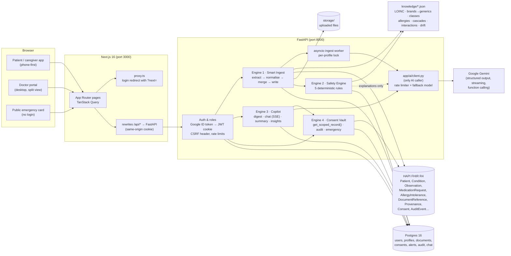
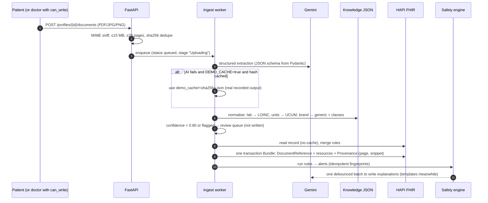

# HealthThread — Architecture

HealthThread is a FastAPI backend and a Next.js frontend in front of two data stores: Postgres for app data and HAPI FHIR R4 for clinical resources. One module talks to the AI (Google Gemini).

## Ingest pipeline (Engine 1)

The stages the UI shows are: Uploading → Reading document → Extracting with AI → Normalising codes & units → Merging with existing record → Saving to FHIR → Running safety checks → Done.

## Consent enforcement (Engine 4)

Every doctor-facing read goes through `services/consent.get_scoped_record(profile_id, viewer)`:

1. **`resolve_access`**: an owner gets everything. A verified doctor needs an active, unexpired consent (expiry is checked on every request, and revocation takes effect immediately). Admins and other users get 403.
2. **`filter_record`**: keeps only resources inside the consent scopes. Mental-health conditions and psychiatric medicines also need `mental_health`. Documents are *listable* when `documents`/`notes` is granted, and *citable* when everything extracted from them is visible.
3. **Copilot prompts, summaries, insights tools, alerts, timeline, trends, documents and the prescribe-time check** all use the scoped record. The prescribe check runs on the full record but redacts findings that involve hidden data.

Every doctor view, chat, summary, upload, prescription, alert review, sharing change and emergency view is written to `audit_events`, mirrored to HAPI as FHIR `AuditEvent`, and shown in the patient's access log.

## Safety engine (Engine 2)

The rules are pure functions over a `PatientRecord` dataclass, so they are unit-tested without HAPI.

| Rule | Fires when | Severity |
|---|---|---|
| `duplicate_therapy` | ≥ 2 active orders share a molecule (including inside combinations), or two drugs from a listed class | warning |
| `allergy_conflict` | any current or past medicine is in a recorded allergy's class (cross-reactivity) | critical |
| `prescribing_cascade` | a marker drug starts within the window after an index drug that is still being taken | warning |
| `lab_drift` | regression slope moves the bad way faster than the rule's minimum (≥ 3 points, ≥ 180 days), plus the metformin/eGFR drug–lab check | warning / critical |
| `interaction` | curated pairs active at the same time | warning |

An alert's fingerprint is `sha256(profile, rule, sorted evidence ids)`, so re-runs are idempotent. When the evidence changes, the old alert is superseded by a new one. "Reviewed — intentional" alerts stay quiet until their evidence changes.

## AI usage (Gemini)

| Feature | Call | Grounding |
|---|---|---|
| Extraction | `generate_structured` (PDF/image part, JSON schema, temperature 0) | only the document |
| Alert explanations | one batched `generate_structured` | the rule's facts; the disclaimer is enforced in code |
| Copilot chat | `stream_text` → SSE | scoped digest with `[Type/id]` keys; keys verified |
| Specialty summary | `generate_structured`, cached per record version | scoped digest; uncited lines flagged |
| Panel insights | manual function-calling loop (≤ 6 steps) | 4 server-side tools over consented records only |
| Patient explainer | `generate_text` | only the items read from that document |

All calls go through a process-wide rate limiter (`AI_REQUESTS_PER_MINUTE`), wait out 429/503 using Google's `retryDelay`, and switch to `GEMINI_FALLBACK_MODEL` when the primary model's quota is exhausted. Only purpose, model, latency and token counts are logged, never content.
